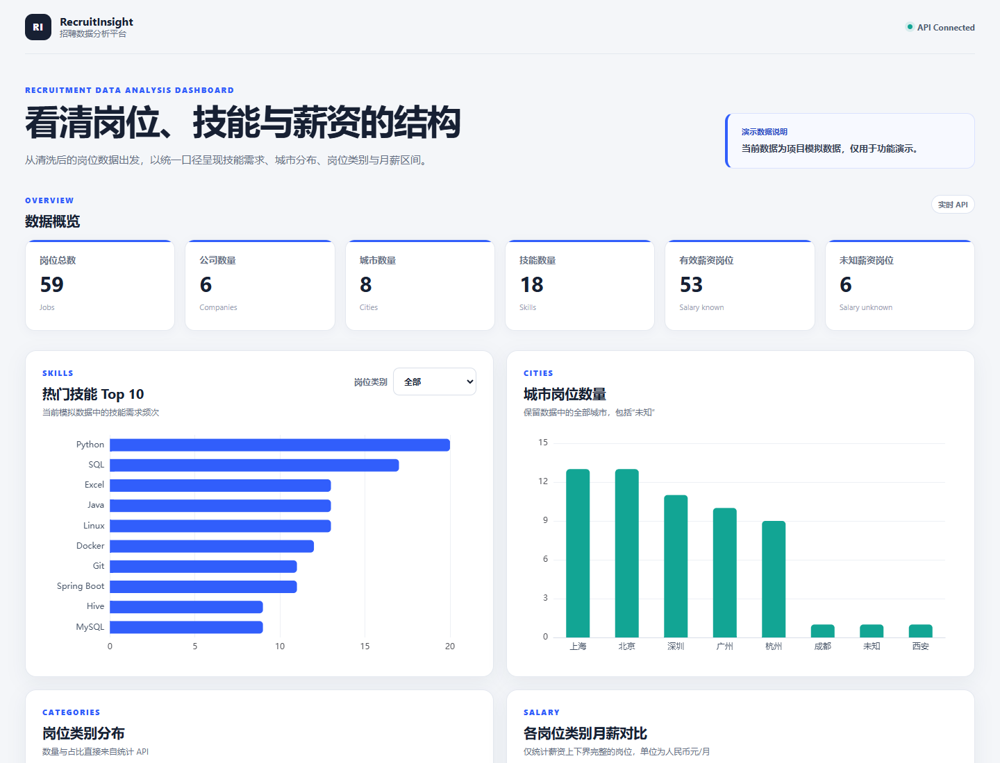
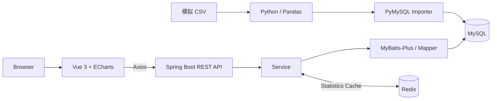
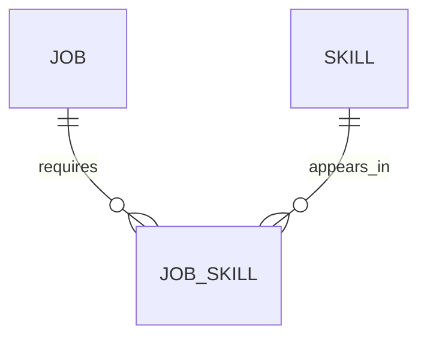

# RecruitInsight

RecruitInsight 是一个基于 Spring Boot、Vue 3 与 Python 的招聘数据分析平台，完成招聘数据清洗、结构化存储、动态查询、统计分析、可视化与数据库性能优化。

> **数据声明：** 当前仓库中的招聘记录均为项目模拟数据，仅用于功能开发和技术验证，不代表真实企业招聘信息或真实招聘市场，也不来自招聘网站爬取。

## Dashboard Preview



更多页面：[统计图表](docs/images/dashboard-statistics.png) · [岗位查询](docs/images/job-search.png)

## Features

- Pandas Pipeline：文本补齐、城市标准化、薪资解析、岗位分类、技能抽取与业务键去重
- CSV → MySQL 幂等导入，正确处理 Pandas 缺失值与 SQL `NULL`
- `job` / `skill` / `job_skill` 多对多数据建模
- 岗位后端分页与 `keyword` / `city` / `category` / `company` 组合筛选
- 概览、城市、岗位类别、热门技能和薪资聚合 API
- Vue 3 + ECharts 单页数据分析 Dashboard
- 基于真实 `EXPLAIN` / `EXPLAIN ANALYZE` 的 MySQL 联合索引优化
- Redis + Spring Cache 统计缓存、参数化 key、JSON 序列化与 600 秒 TTL
- 独立 30,000 条模拟压力测试数据集，不污染 59 条正常演示数据

## Tech Stack

| Layer | Technologies |
| --- | --- |
| Backend | Java 21, Spring Boot 4.1.1, MyBatis-Plus 3.5.17, Spring Cache, Maven |
| Database & Cache | MySQL 8.4, Redis 8.10 |
| Data | Python 3.12, Pandas 3, PyMySQL |
| Frontend | Vue 3, Vite 8, Axios, ECharts 6 |
| Development | Git, IntelliJ IDEA, WSL 2, Ubuntu 24.04 |

## Architecture



详细说明见 [Architecture](docs/architecture.md)。

## Data Flow

```text
Raw CSV
  → Pandas Cleaning
  → Processed CSV
  → PyMySQL Importer
  → MySQL
  → Spring Boot REST API
  → Vue 3 / ECharts Dashboard
```

清洗阶段包括文本规范化、城市标准化、岗位分类、薪资解析、技能抽取和业务去重。完整流程见 [Data Pipeline](docs/data-pipeline.md)。

## Database Design

一个 Job 可以要求多个 Skill，同一 Skill 也可以出现在多个 Job 中，因此通过 `job_skill` 中间表实现多对多关系：



- `job`：岗位属性、标准化城市/类别、薪资范围和发布日期
- `skill`：18 种规范技能字典
- `job_skill`：以 `(job_id, skill_id)` 为联合主键的关系表

字段、外键和导入策略见 [Database Design](docs/database-design.md)。

## Core API

| Endpoint | Description |
| --- | --- |
| `GET /api/jobs` | 岗位后端分页与组合筛选 |
| `GET /api/statistics/overview` | 岗位、公司、城市、技能与薪资完整度概览 |
| `GET /api/statistics/skills` | 热门技能 Top N，可按类别筛选 |
| `GET /api/statistics/cities` | 城市岗位数量 |
| `GET /api/statistics/categories` | 岗位类别数量与占比 |
| `GET /api/statistics/salary` | 各类别月薪均值 |

`/api/jobs` 支持 `page`、`size`、`keyword`、`city`、`category`、`company`；`size` 范围为 1～100。统计 SQL 说明见 [Statistics SQL](docs/statistics-sql.md)。

## Performance Optimization

数据库性能测试使用隔离的 `recruit_insight_perf`：30,000 条程序生成的模拟岗位、119,971 条 `job_skill` 关系。每条 SQL 预热 3 次并正式测量 10 次，以 median 为主要指标。

| Query | Before | After | Result |
| --- | ---: | ---: | ---: |
| city + category 深分页 | 9.4676 ms | 0.8431 ms | +91.09% |
| category 分页 | 9.8742 ms | 0.4049 ms | +95.90% |
| 城市聚合 | 10.1635 ms | 3.6256 ms | +64.33% |
| 薪资聚合 | 21.0575 ms | 8.6212 ms | +59.06% |
| Skills Top 10 | 156.8076 ms | 167.4717 ms | -6.80% |

新增 job 索引不会优化所有聚合 SQL：Skills Top 10 仍需处理全部关系并执行聚合，本轮结果略慢，项目没有隐藏负向数据。`title LIKE '%Java%'` 仍为全表扫描，因为前导通配符难以利用普通 B-Tree；当前规模没有为此引入 Elasticsearch。

完整 SQL、执行计划和原始样本见 [Before / After](docs/performance-before-after.md) 与 [Optimization Design](docs/performance-optimization.md)。

## Redis Cache

Spring Cache 只缓存 `overview`、`skills`、`cities`、`categories`、`salary`。skills key 同时包含 category 和 limit，例如 `statistics:skills:后端开发:10`。

`/api/jobs` 不缓存：分页与组合筛选参数空间较大，当前阶段缓存收益有限。统计缓存 TTL 实测为 600 秒，采用 JSON 序列化。正常演示数据库只有 59 条数据，因此实际收益有限：

- Cache Miss median：18.6485 ms
- Cache Hit median：8.6194 ms

Python importer 更新数据库后不会主动清除缓存，当前采用最多约 10 分钟的 TTL 最终一致性。

## Testing

本阶段实际验证结果：

- Python：`40 tests passed`，包含原有数据清洗与导入测试
- Backend：`mvn -f backend/pom.xml clean compile` → `BUILD SUCCESS`
- Frontend：`npm run build` → 成功
- MySQL：实际 `EXPLAIN`、`EXPLAIN ANALYZE` 与索引前后 10 次测量
- Redis：Cache Miss / Hit、不同参数 key、JSON 反序列化与 TTL 下降
- Integration：岗位与全部统计 API、Vue Dashboard、浏览器 Console

## Project Structure

```text
RecruitInsight/
├── backend/        # Spring Boot REST API 与 Spring Cache
├── frontend/       # Vue 3 + ECharts Dashboard
├── data-analysis/  # Pandas 清洗、导入与 benchmark
├── dataset/        # 模拟 raw / processed 数据及 perf 说明
├── sql/            # Schema、关系表和查询索引
├── docs/           # 设计、性能报告、架构图与截图
└── README.md
```

## Run Locally

### 1. Prerequisites

- Java 21、Maven
- MySQL 8.4
- Python 3.12
- Node.js 20.19+、npm
- WSL 2 + Ubuntu 24.04 + Redis

### 2. Python environment and cleaning

在项目根目录执行：

```powershell
python -m pip install -r data-analysis/requirements.txt
python data-analysis/src/clean_jobs.py
python -m unittest discover -s data-analysis/tests -v
```

### 3. MySQL schema and import

从项目根目录进入 MySQL CLI：

```powershell
mysql -u <local-username> -p
```

在 MySQL CLI 中按顺序执行：

```sql
SOURCE sql/000_create_database.sql;
SOURCE sql/001_create_job_table.sql;
SOURCE sql/004_extend_job_table.sql;
SOURCE sql/005_create_skill_tables.sql;
SOURCE sql/006_prepare_clean_import.sql;
SOURCE sql/007_add_query_indexes.sql;
```

退出 MySQL CLI，在 PowerShell 中设置当前进程环境变量并导入 59 条清洗数据：

```powershell
$env:DB_HOST = "127.0.0.1"
$env:DB_PORT = "3306"
$env:DB_NAME = "recruit_insight"
$env:DB_USERNAME = "<local-username>"
$env:DB_PASSWORD = "<local-password>"
python data-analysis/src/import_jobs.py
```

不要把真实密码写入仓库。Importer 使用唯一 `source_id` 幂等更新岗位。

### 4. Redis on WSL

打开 Ubuntu 并保持该终端会话运行：

```powershell
wsl -d Ubuntu-24.04
```

在 Ubuntu 中检查服务：

```bash
sudo systemctl start redis-server
redis-cli PING
```

必须返回 `PONG`。本地配置保持 `bind 127.0.0.1`、`protected-mode yes`；Windows 后端通过 `localhost:6379` 连接。

### 5. Spring Boot

在已设置数据库环境变量的 PowerShell 中执行：

```powershell
$env:REDIS_HOST = "127.0.0.1"
$env:REDIS_PORT = "6379"
mvn -f backend/pom.xml spring-boot:run
```

API 地址：`http://127.0.0.1:8080/api/jobs`

### 6. Vue Dashboard

新建一个 PowerShell：

```powershell
npm --prefix frontend install
npm --prefix frontend run dev
```

浏览器访问 `http://127.0.0.1:5173`。Vite 将 `/api` 代理到本地 Spring Boot，无需为开发环境开放全局 CORS。

## Documentation

- [Architecture](docs/architecture.md)
- [Data Pipeline](docs/data-pipeline.md)
- [Data Cleaning Report](docs/data-cleaning-report.md)
- [Database Design](docs/database-design.md)
- [Statistics SQL](docs/statistics-sql.md)
- [Performance Before / After](docs/performance-before-after.md)
- [Performance Optimization](docs/performance-optimization.md)

## License

尚未选择开源许可证；公开发布前将由仓库所有者决定。
