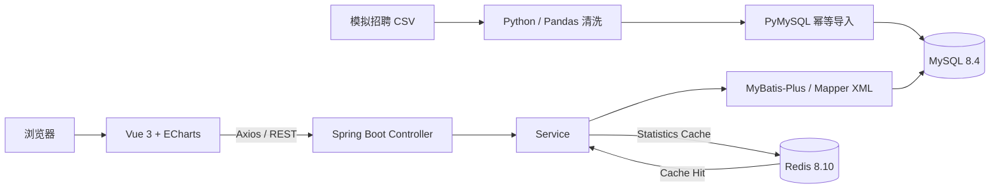

# RecruitInsight Architecture

> 所有招聘记录均为项目模拟数据，仅用于功能开发和技术验证。

## 模块职责

- `data-analysis`：清洗模拟 CSV、生成独立性能数据、导入 MySQL、执行 benchmark。
- `backend`：岗位分页与组合筛选、统计聚合、Redis 统计缓存。
- `frontend`：调用 REST API，展示概览、图表和岗位分页结果。
- `sql`：数据库结构、关系表和经 EXPLAIN 验证的查询索引。
- `docs`：数据设计、SQL、性能实测、架构与公开截图。

## 请求路径

普通岗位查询直接经过 Service 与 MySQL，不进入缓存。统计请求先访问 Spring Cache；命中时从 Redis 返回，未命中时由 Mapper 查询 MySQL，并将 JSON 序列化结果写入 Redis，TTL 为 600 秒。
