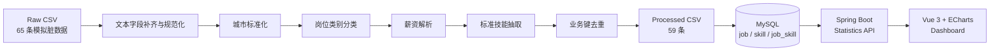

# Recruitment Data Pipeline

> Pipeline 输入与输出均为项目模拟数据，不代表真实招聘市场。

## 关键规则

- 城市：统一常见“市”和城区后缀，无法映射的值保留原值。
- 分类：按数据开发、数据分析、算法、测试、后端开发等有优先级的规则匹配。
- 薪资：月薪统一为人民币元，`N-MK·X薪` 分离月薪范围与发薪月数；日薪按 21.75 个工作日折算。
- 缺失：面议或无法解析的薪资保留为空，导入 MySQL 时转换为 SQL `NULL`。
- 技能：固定 18 种标准技能，忽略英文大小写并统一别名。
- 去重：使用 `title + company + city + publish_date` 作为业务去重键。
- 导入：岗位按唯一 `source_id` upsert，技能按唯一名称 upsert，并重建岗位技能关系。

固定输入执行 Pipeline 会得到一致的 59 条清洗结果；性能实验另用固定随机种子生成 30,000 条模拟压力测试数据，不会覆盖正常数据集。
