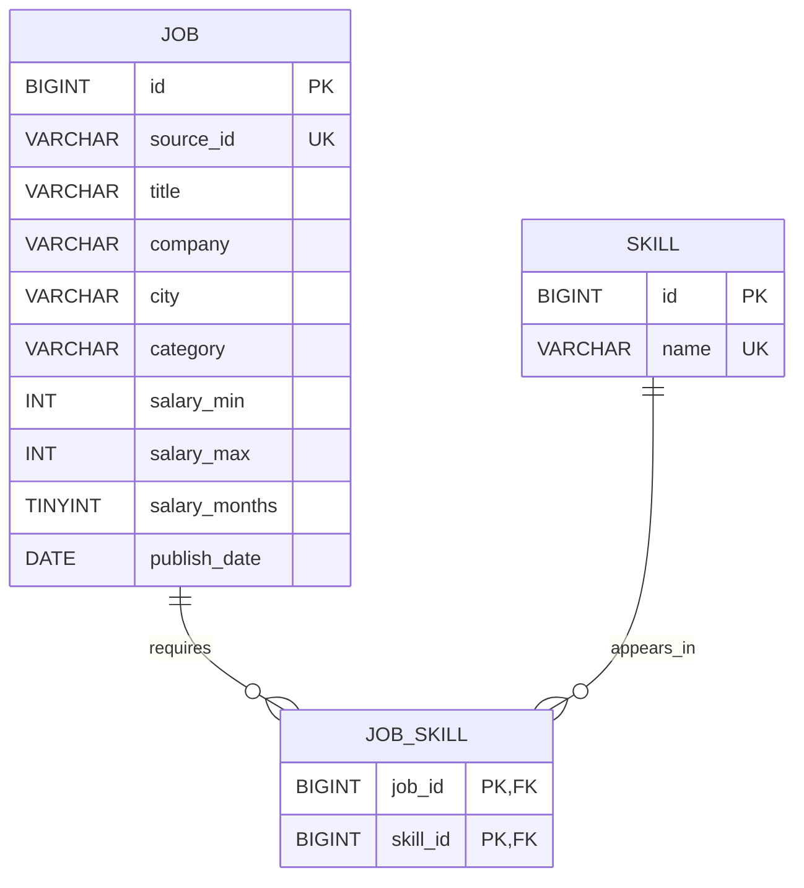

# 招聘数据数据库设计

> 当前数据库中的岗位和技能均来自项目内的模拟测试 CSV，不代表真实招聘市场数据。

## 数据流

```text
raw CSV
  → Pandas cleaning
  → processed CSV
  → PyMySQL importer
  → job / skill / job_skill
  → Spring Boot API
```

## ER 图



`job` 与 `skill` 是多对多关系：一个岗位可以要求多个技能，同一技能也可以出现在多个岗位中；`job_skill` 将它拆成两个一对多关系。

## job

`job` 保存岗位自身的结构化属性。`source_id` 对应清洗 CSV 的原始记录 ID，并通过唯一索引支持重复导入时更新同一岗位。未知薪资使用 SQL `NULL`，不使用 0。`created_at` 和 `updated_at` 继续由数据库维护。

新增字段：

- `source_id VARCHAR(64)`：CSV 来源记录 ID，唯一。
- `education VARCHAR(50)`：学历要求。
- `salary_months TINYINT UNSIGNED NULL`：一年发薪月数，与月薪范围分离。

## skill

`skill` 是规范化技能字典。`name` 建立唯一约束，确保 Java、Python、Spring Boot 等每种规范技能只保存一次。

## job_skill

一个岗位可以要求多个技能，同一技能也会出现在多个岗位中，因此 Job 与 Skill 是多对多关系。`job_skill` 使用 `(job_id, skill_id)` 联合主键，既表达关联，也防止重复关系。

`job_skill.job_id` 外键指向 `job.id` 并使用 `ON DELETE CASCADE`，岗位删除时其技能关系自动清理；`skill_id` 外键指向 `skill.id`。

## 导入策略

- 数据库连接信息只从环境变量读取，不写入仓库。
- 单次导入在一个事务内完成，失败时整体回滚。
- 岗位按唯一 `source_id` 执行 upsert。
- 技能按唯一 `name` 执行 upsert。
- 每次更新岗位时重建该岗位的技能关系，并删除不再被引用的技能。
